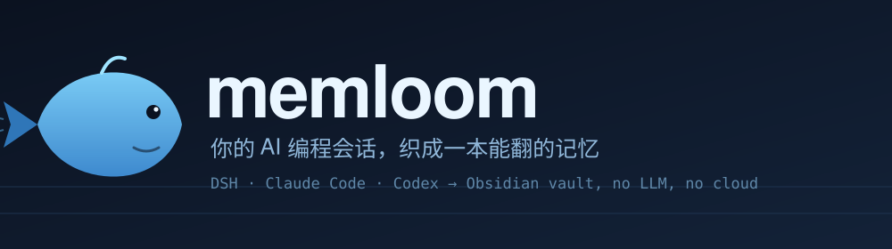

<p align="center">
  
</p>

<p align="center">
  <b>把本地的 AI 编程会话，织成一本能翻、能链、能搜索的 Obsidian 记忆库。</b><br>
  <sub>Turn your AI coding sessions into a navigable Obsidian memory vault — local, offline, no LLM required.</sub>
</p>

<p align="center">
  <code>python -m memloom build</code> &nbsp;→&nbsp; 打开 <code>vault/</code> 就是一本库
</p>

---

## 这是什么

你每天都在跟 AI 写代码。DSH、Claude Code、Codex 把每次对话都存成了本地档案 —— 但它们是一堆 `.zstd`、`.jsonl`，散在若干个隐藏目录里。**这些档案里装着你解决问题的全部过程，却几乎不可能被再次读到。**

memloom 把这些档案读成一本 Obsidian 库：

```
vault/
├── 00-总索引.md          项目地图 + 主题分类 + 时间线
├── 10-项目/              按工作目录 + 共享文件聚类出的项目页
├── 20-会话/              一次会话一页：你问的、它答的、跑了什么、错在哪
├── 30-主题/              踩坑 / 代码 / 工具 —— 同类问题跨会话归到一起
├── 90-原文归档/          原始档案的位置（不复制、只索引）
└── 99-使用说明.md        这本库是怎么生成的、哪些字是机器写的
```

页面之间全部用 `[[双链]]` 连着 —— 打开一篇会话，可以直接跳回它所属的项目、它踩过的坑、它碰过的文件。

不想先跑一遍？[`examples/sample-vault/`](examples/README.md) 里有五页真实生成的输出（索引、一页会话、一页主题、归档表、说明书），可以先看看这本库长什么样。

## 设计上的三条硬规矩

| 规矩 | 意味着什么 |
|---|---|
| **零第三方运行时依赖** | 纯 Python 标准库，3.9+ 能跑。没有 `pip install` 失败、没有依赖冲突、没有供应链风险。 |
| **不用 LLM** | 路径、命令、错误、工具统计、标题全部由规则抽取。同一批档案跑两次，结果逐字节一致 —— 可以进 git、可以 diff。 |
| **只读你的档案** | 不修改、不移动、不在档案目录里写任何东西；不上传任何内容。唯一写的地方是你指定的 `--out`。 |

> LLM 增强（给主题起更像人话的名字、跨会话总结）留在 v0.2，且永远是**可选的开关**，不是前置条件。

## 不想要输出？

`--dry-run` 只算不写盘；`memloom scan` 连页面都不生成，只报每条来源有多少档案。想先确认自己的档案能不能读：`memloom doctor`。

## 快速开始

```bash
git clone https://github.com/<you>/memloom.git
cd memloom
python -m memloom doctor      # 先看这台机器上有没有档案、压缩后端能不能用
python -m memloom scan        # 只列出找到的档案，不解析
python -m memloom build --out vault
```

然后用 Obsidian 的「打开文件夹作为仓库」指到 `vault/`。

装成命令（可选）：

```bash
pip install -e .              # 之后可以直接 memloom build
pip install -e ".[zstd]"      # 顺手装 pyzstd，解压更快（不是必需）
```

## 命令

| 命令 | 作用 |
|---|---|
| `memloom doctor` | 体检：默认档案目录在不在、zstd 后端走的哪条路、能不能写盘 |
| `memloom scan [--root NAME=PATH]` | 只扫描，打印每条来源的档案数、总量、后端 |
| `memloom build --out DIR` | 生成整本库（默认扫所有已知来源） |
| `memloom build --root dsh=~/.dsh/sessions` | 只扫指定来源；可重复传 `--root` |
| `memloom build --since 30 --min-turns 3` | 只收最近 30 天、且轮次 ≥ 3 的会话 |
| `memloom build --dry-run` | 只算不写，看看会生成多少页 |
| `memloom build --full` | 忽略增量缓存，全部重新解析 |

`--adapter auto|dsh|claude-code|codex` 强制指定某个适配器（默认按文件特征自动判断）。

### 第二次跑为什么快

每次 `build` 都在输出目录里留一份 `<out>/.memloom/`：一个 `state.json`（每条档案的 size + mtime_ns + 适配器名）和一份解析结果的缓存。下次跑只有**真的变过的档案**才会被重新解析，其余直接读缓存。缓存只写在你指定的输出目录里，**绝不写进你的档案目录**（那些目录本来就是只读的）。

```
$ memloom build --out vault        # 第一次：117 个档案 / 289 MB，全部解析
会话   117
主题   60
页面   189（本次改动 189）
项目   9
缓存   复用 0 / 新解析 117
耗时   14.1s

$ memloom build --out vault        # 再跑一次，档案没动
页面   189（本次改动 0）
缓存   复用 117 / 新解析 0
耗时   3.26s

$ memloom build --out vault        # 第三次
页面   189（本次改动 0）
耗时   0.64s
```

（数字取自作者机器 2026-11-14 的一次实测。第二次剩下的开销只有读缓存和比对，第三次连解码都省了；如果某个档案还在增长——比如你正开着别的编辑器边写边跑——那**一份**会重新解析，其余照旧命中。你自己的档案数量和耗时当然不会一样。）

写盘也是增量的：内容没变就不碰文件、只删带生成标记的旧页 —— 所以重复跑是零写入，Obsidian 不会因为一次重建把你看的页面刷掉。缓存坏了、换了版本、想强制重来：`--full` 或直接删掉 `<out>/.memloom/`。

## 支持哪些档案

| 来源 | 路径 | 状态 |
|---|---|---|
| **DSH** | `~/.dsh/sessions/**/*.zstd` | ✅ 已验证（本机 89 个真实档案 / 69 MB） |
| **Claude Code** | `~/.claude/projects/<project>/*.jsonl` | ✅ 已验证（本机 27 个真实文件 / 219 MB，最大一个 120 MB） |
| **Codex** | `~/.codex/sessions/**/*.jsonl` | ⚠️ beta：适配器按已知格式写好，但本机没有 Codex 档案，**未经真实数据验证** |

DSH 的 `.zstd` 是多 frame 拼接的老格式，标准库解不开。memloom 按顺序尝试：`pyzstd` → Python 3.14+ 的 `compression.zstd` → 本机 `node` 的 `zlib.zstdDecompressSync` → `zstd` 命令行；四条路都不通时给一句能照做的报错，而不是 traceback。

适配器是插件式的：一个来源 = 一个类（`memloom/adapters/*.py`），实现 `match` / `sniff` / `load`。加一个新来源不需要动主流程，见 [docs/adapters.md](docs/adapters.md)。

## 它是怎么把会话变成项目的

大多数人的问题是**所有会话都跑在同一个工作目录里**（比如同一个 workspace），所以「一个目录 = 一个项目」会把一百次会话塌成一个没用的页面。

memloom 的做法：

1. 先按规范化后的 `cwd` 分桶；
2. 用**碰过的文件**做并查集，把明显属于同一件事的桶合并；
3. 桶太大（默认 > 12 个会话）时，按共享文件重新切分，并用主要目录给它命名；
4. 主题不是「关键词」而是三件可验证的事：同一错误指纹出现在 ≥ 2 个会话里（`踩坑`）、同一二级路径出现在 ≥ 3 个会话里（`代码`）、同一个非通用命令出现在 ≥ 3 个会话里（`工具`）。

细节和取舍写在 [docs/architecture.md](docs/architecture.md)。

## 已知局限（写在这里，不藏在代码里）

- **主题名是规则拼出来的**，可能不好听（`踩坑-Error- ECONNREFUSED`）。要更像人话的名字得等 v0.2 的可选 LLM 步骤。
- **页面不含 LLM 撰写的内容**。所有正文都来自你的 prompt、模型的回复、工具输出，和规则抽取 —— `99-使用说明.md` 里也这么写。
- **Codex 适配器未验证**（见上表）。
- **不做语义搜索**。链接和分类是结构化的；找关键词请用 Obsidian 自带搜索。

## 测试

```bash
python -m unittest discover -s tests -t .
```

47 个测试，跑 0.5 秒。fixture 是从真实档案里裁剪出来的（DSH 的紧凑事件流、Claude 的 `.jsonl`、Codex 的 rollout），不是手编的假数据 —— 格式变了测试会先红。

改完代码想确认没把「第二次构建是 no-op」这条核心承诺弄坏，跑一条命令就够：

```bash
python tools/preflight.py
```

它会检查编码与换行是否干净、仓库里有没有混进你本机的绝对路径、元数据是否齐全、测试是否全绿、以及**第二次 build 是否真的 0 改动**。零依赖，退出码即结论。

## 路线图

- **v0.1**（本仓库）：三种适配器、规则抽取、项目/主题聚类、vault 渲染、增量解析（`.memloom/` 状态 + 解析缓存）、`doctor` / `scan` / `build`。
- **v0.2**：`--enrich` 可选的 LLM 主题命名、更多来源（Cursor、Gemini CLI、Copilot）、跨机器共享缓存。
- **v0.3**：把「同一个 bug 在三个项目里复发过」这类跨项目线索自动挖出来。

## 许可

MIT。归档格式属于各自工具的作者，memloom 只读你自己机器上的文件。
